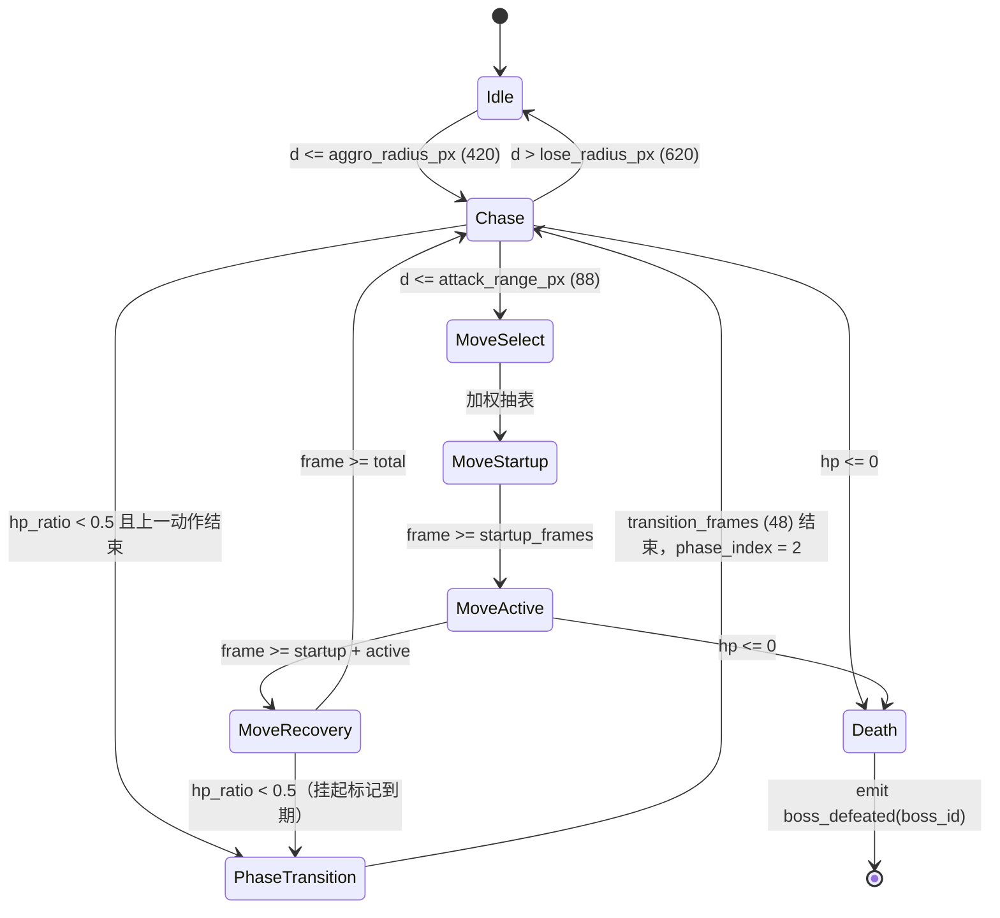

# 战斗系统设计 v1.0（2 号工位）

> 对应总纲 **3.4 战斗系统：数据驱动**；里程碑 **M1**（移动 / 翻滚 / 轻攻击 + 追击敌人）、**M5**（恶兆妖鬼二阶段 + 3 个核心招式）。
> 配套文件：`数据表schema.md`（字段真源）、`boss_01_margit.tres`（数值实例）、`player_state_machine.gd`（代码骨架）、`接口契约.md`（I-1/I-2/I-3/I-4/I-6）、`README.md`（待裁决）。
> 核心验收：**数据表改数值不改代码**。所有数值均给出具体数字，极值可复算。
> 引擎：Godot 4 标准版 / GDScript。逻辑帧固定 60 FPS（`PlayerActionData.logic_fps = 60`，须等于 `Engine.physics_ticks_per_second`）。

---

## 1. 玩家状态机

### 1.1 状态枚举与 M1 动作表（8 条 `PlayerActionData`，M1 落地时生成 `res://data/player/player_actions.tres`）

| state_name | id | pose_name | startup | active | recovery | invuln `[s,e)` | speed px/s | base_attack | motion_mult | poise_dmg | hitbox px | priority | cancel_window | can_cancel_into |
|---|---|---|---|---|---|---|---|---|---|---|---|---|---|---|
| `idle` | `action_01_idle` | `idle` | 0 | 1 | 0 | `[-1,-1)` 无 | 0 | 0 | 0 | 0 | 0 | 0 | 0 | `[]` |
| `walk` | `action_02_walk` | `walk` | 0 | 1 | 0 | `[-1,-1)` 无 | 96 | 0 | 0 | 0 | 0 | 10 | 0 | `[]` |
| `run` | `action_03_run` | `run` | 0 | 1 | 0 | `[-1,-1)` 无 | 168 | 0 | 0 | 0 | 0 | 20 | 0 | `[]` |
| `roll` | `action_04_roll` | `roll` | 4 | 9 | 9 | `[4,13)` | 260 | 0 | 0 | 0 | 0 | 60 | 0 | `["idle","walk","run"]` |
| `attack_light` | `action_05_attack_light` | `attack_light` | 8 | 5 | 14 | `[-1,-1)` 无 | 0 | 85 | 1.00 | 18 | 62 | 40 | 6 | `["roll","attack_light","attack_heavy"]` |
| `attack_heavy` | `action_06_attack_heavy` | `attack_heavy` | 20 | 8 | 26 | `[-1,-1)` 无 | 0 | 85 | 1.65 | 42 | 78 | 45 | 8 | `["roll","attack_light","attack_heavy"]` |
| `hitstun` | `action_07_hitstun` | `hitstun` | 0 | 12 | 6 | `[-1,-1)` 无 | 0 | 0 | 0 | 0 | 0 | 70 | 0 | `["death"]` |
| `death` | `action_08_death` | `death` | 0 | 48 | 0 | `[-1,-1)` 无 | 0 | 0 | 0 | 0 | 0 | 100 | 0 | `[]` |

全表 `logic_fps = 60`、`stamina_cost = 0.0`、`pose_frame_offset = 0`、三种 `status_buildup_* = 0.0`（M1 未启用武器异常）。满足 E-6：8 状态齐全、`state_priority` 互异、`logic_fps` 全等。

### 1.2 转移优先级（数值全部来自 `state_priority` 字段，代码中无优先级表）

| 序 | 状态 | 优先级 | 说明 |
|---|---|---|---|
| 1 | `death` | 100 | 最高，任何状态可进入；进入后拒绝一切 `request_state` |
| 2 | `hitstun` | 70 | 受击打断一切非死亡状态 |
| 3 | `roll` | 60 | 可取消轻 / 重攻击的后摇（法环手感） |
| 4 | `attack_heavy` | 45 | 不能被轻攻击打断 |
| 5 | `attack_light` | 40 | 可被重攻击直接接续（连段） |
| 6 | `run` | 20 | 持续状态 |
| 7 | `walk` | 10 | 持续状态 |
| 8 | `idle` | 0 | 兜底持续状态 |

**转移规则（`request_state()`）**：
1. `death` 为当前状态时拒绝一切转移。
2. 目标 `state_priority >= 当前 state_priority` → 立即放行（同优先级允许 `walk`↔`run` 等持续状态互切）。
3. 目标优先级更低 → 仅当「当前动作已结束（`state_frame >= total`）」或「处于取消窗口 `[total - cancel_window_frames, total)`」**且**目标名在 `can_cancel_into` 白名单内才放行。
4. `idle / walk / run / death` 为持续状态，不因 `state_frame >= total` 自动回 idle；其余 4 个状态动作结束后自动回 `idle`。

### 1.3 enter / exit 行为

| 时机 | 动作 |
|---|---|
| `_enter_state` | `state_frame = 0`；清空本次命中表；`_was_invulnerable = false`；立刻按 `pose_frame_offset + 0` 调 `set_pose()` 锁首帧；`death` 额外发 `death_confirmed()` |
| `_physics_process` | `state_frame += 1` → 调 `set_pose(pose_name, pose_frame_offset + state_frame)` → 检查 `is_invulnerable()` 变化发 `invulnerability_changed` → 非持续状态且 `state_frame >= total` 则回 `idle` |
| `_exit_state` | 清空命中表；若上一状态仍在无敌窗口，补发 `invulnerability_changed(false)` |
| 命中去重 | `register_hit(target_id)` 保证同一动作对同一目标只结算一次 |

---

## 2. 翻滚无敌帧（M1 验收项）

> **R19 裁决修正（cmd-20261109-102334-084-A2 / 总指挥裁决，依据 `00-汇总.md` §5 M1 验收与用户原始需求）**：本节 `action_04_roll` 翻滚帧口径改前 `4/12/12=28`、无敌 `[4,16)`（`invulnerable_end_frame=16`）→ 改后 **`4/9/9=22`、无敌 `[4,13)`（`invulnerable_end_frame=13`）**；E-7 自洽 `inv_end = startup + active = 4+9 = 13`。`startup_frames=4`、`invulnerable_start_frame=4`、`move_speed_px_per_sec=260.0`、`logic_fps=60` 等其余字段不变。`total_frames` 依 schema E-2 不设字段、由 `4+9+9=22` 派生。运行权威件 `godot/data/combat/player_actions.tres` 已同步修正。

### 2.1 帧分段与数据表字段

以 `action_04_roll` 为例，`logic_fps = 60`（1 帧 = 16.67 ms）：

| 段 | 数据表字段 | 帧数 | 帧区间（左闭右开） | 秒数 | 行为 |
|---|---|---|---|---|---|
| 起手 | `startup_frames` | **4** | `[0, 4)` | 0.000–0.067 s | 有伤害判定（可被击中），已开始位移 |
| 无敌 / 翻滚主体 | `active_frames` | **9** | `[4, 13)` | 0.067–0.217 s | `is_invulnerable() == true`，免疫一切伤害 |
| 恢复 | `recovery_frames` | **9** | `[13, 22)` | 0.217–0.367 s | 有伤害判定，不可取消（除白名单） |
| 合计 | 派生（不设字段） | **22** | `[0, 22)` | 0.367 s | 结束回 `idle` |

字段取值：`invulnerable_start_frame = 4`、`invulnerable_end_frame = 13`。

### 2.2 自洽等式（E-7，可在运行时自检）

```
total                = startup_frames + active_frames + recovery_frames = 4 + 9 + 9 = 22
invulnerable_length  = invulnerable_end_frame - invulnerable_start_frame = 13 - 4 = 9 = active_frames
invulnerable_start_frame = startup_frames                       → 4 = 4
invulnerable_end_frame   = startup_frames + active_frames      → 13 = 4 + 9
0 <= invulnerable_start_frame < invulnerable_end_frame <= total  → 0 <= 4 < 13 <= 22
判定式：is_invulnerable() ⇔ state_frame ∈ [4, 13)  （左闭右开，第 13 帧起恢复受击）
```

非无敌动作两端写 `-1`，`is_invulnerable()` 因 `start < 0` 直接返回 `false`，无需分支常量。

### 2.3 验收口径

不改代码，只把 `action_04_roll.invulnerable_end_frame` 从 `13` 改成 `20`（同时把 `active_frames` 改成 `16` 以满足 E-7），无敌段时长应从 `9 帧 / 0.150 s` 变为 `16 帧 / 0.267 s`；在 Boss `move_01_dagger_slash` 的判定帧 `[18, 23)` 内触发翻滚，第 4–12 帧应免伤、第 13 帧起应正常受伤。**这条是本模块 M1 的可复核验收**（演示目标值 `20 / 16` 为改表演示用假设值，非本轮落地数值）。

---

## 3. 韧性 / 削韧 / 处决 与 异常状态积累

### 3.1 韧性（poise）结算

运行时维护 `当前韧性 P`，初值 = `PoiseConfig.max_poise`。

```
受击：  P -= MoveData.poise_damage（或 PlayerActionData.poise_damage）
        重置"最后受击计时" = 0
回复：  若 最后受击计时 >= poise_regen_delay_sec，则 P += poise_regen_per_sec × dt
        上限 clamp(P, 0, max_poise)
崩坏：  P <= 0 → 触发 stance_break，P 复位为 max_poise，
        开启时长 = stance_break_duration_sec 的窗口，
        窗口内对该目标的伤害 × stance_break_damage_multiplier
```

`boss_01_margit.tres` 数值与可复算验算：

| 场景 | max_poise | regen / delay | 玩家重击削韧 | 重击间隔 | 每击净削韧 | 崩坏所需重击数 |
|---|---|---|---|---|---|---|
| P1 `poise_01_margit_base` | 120 | 9.0 /s，3.5 s | 42 | 1.0 s（< delay，不回复） | 42 | `ceil(120/42) = 3` |
| P1 慢节奏 | 120 | 9.0 /s，3.5 s | 42 | 5.0 s | `42 - 9×(5-3.5) = 28.5` | `ceil(120/28.5) = 5` |
| P2 `poise_02_margit_p2` | 150 | 12.0 /s，2.5 s | 42 | 1.0 s | 42 | `ceil(150/42) = 4` |
| 轻击连续（P1） | 120 | 9.0 /s，3.5 s | 18 | 1.0 s | 18 | `ceil(120/18) = 7` |

P2 的 `phase_resistance_multiplier = 1.35`、`phase_defense = 18.0`、`poise_override` 全部由 `PhaseData` 切换，不改代码。

### 3.2 处决触发条件（全部满足）

1. `PoiseConfig.executable == true`；
2. 目标 `当前韧性 <= 0` 且 `崩坏窗口剩余时长 > 0`；
3. 目标 HP 比例 `<= execute_hp_ratio_threshold`（两阶段均为 `0.0`，该条视为恒真，即纯姿态崩坏即可处决）；
4. 攻击者处于 `attack_light` / `attack_heavy` 的判定帧 `[startup, startup + active)` 内；
5. 距离 `<= PlayerActionData.hitbox_reach_px`；
6. 本次动作对该目标尚未结算过命中（`register_hit` 通过）。

处决伤害仍走 §4 公式，其中 `S = stance_break_damage_multiplier`；若达到一击处决规则（M5 可另配），由 3 号订阅 `boss_defeated` 记录，2 号不写 flag。

### 3.3 异常状态积累（出血 / 中毒 / 冻伤）

`BossData.status_buildups` 三条配置：

| 项 | 出血 `status_01_bleed` | 中毒 `status_02_poison` | 冻伤 `status_03_frost` |
|---|---|---|---|
| `threshold` | 180.0 | 210.0 | 160.0 |
| `decay_per_sec` | 7.0 | 6.0 | 5.0 |
| `decay_delay_sec` | 2.0 | 2.5 | 2.0 |
| `trigger_damage_ratio` | 0.12 | 0.0 | 0.08 |
| `trigger_damage_flat` | 0.0 | 40.0 | 0.0 |
| `trigger_poise_damage` | 25.0 | 0.0 | 40.0 |
| `duration_sec` / `tick_damage_per_sec` | 0.0 / 0.0（瞬发） | 20.0 / 12.0 | 30.0 / 0.0（易伤窗口） |
| `resistance_gain_per_trigger` / `max_resistance` | 25.0 / 330.0 | 30.0 / 360.0 | 30.0 / 320.0 |
| `trigger_pose_name` | `status_bleed` | `status_poison` | `status_frost` |

**实际阈值** `= (threshold + 累计抗性) × PhaseData.status_resistance_multiplier`。

| 场景 | 有效阈值 | 每次命中积累 | 触发所需命中 | 触发伤害（对 max_hp=3500 的 Boss） |
|---|---|---|---|---|
| 出血 · P1，无抗性 | `(180+0)×1.0 = 180` | 30（示例武器） | `ceil(180/30) = 6` | `0.12 × 3500 = 420` |
| 出血 · P1，第 2 次触发 | `(180+25)×1.0 = 205` | 30 | `ceil(205/30) = 7` | 420 |
| 出血 · P2（mult 1.35） | `180×1.35 = 243` | 30 | `ceil(243/30) = 9` | 420 |
| 中毒 · P1 | 210 | 35 | 6 | `40 + 20 s × 12 /s = 280` |
| 冻伤 · P1 | 160 | 40 | 4 | `0.08 × 3500 = 280`，另加削韧 40 |

**衰减 / 延迟复算（出血）**：最后一次积累后 `2.0 s` 内不衰减；之后以 `7.0 /s` 递减。若玩家每 `1.2 s` 命中一次（间隔 < 2.0 s），积累只增不减，6 击触发；若间隔 `3.0 s`，每击之间衰减 `7×(3-2) = 7`，净积累 `30-7 = 23`，`ceil(180/23) = 8` 击才触发。**这条把「攒异常要贴身连打」变成可算的数值结论，而非手感口号。**

**结算顺序**：命中 → 按 `MoveData.status_buildup_<type>` 累加 → 重置衰减计时 → 若 `积累值 >= 实际阈值` 则触发（伤害 / 削韧 / pose / `resistance_gain_per_trigger` 入累计抗性，上限 `max_resistance`）→ 积累值归零。**触发伤害不吃招式倍率与阶段倍率**，避免乘法套娃。Boss `move_03_holy_hammer` 自带 `status_buildup_frost = 35.0`，即 P2 新增的冻伤来源。

---

## 4. 伤害公式与「禁止硬编码」清单

### 4.1 公式与字段来源

```
伤害 = max(MIN_DAMAGE, A × M × P × S − D)
```

| 符号 | 含义 | 数据表字段来源（玩家 / 敌人 / Boss） |
|---|---|---|
| A | 攻击力 | `PlayerActionData.base_attack` / `EnemyData.base_attack` / `BossData.base_attack` |
| M | 招式倍率 | `PlayerActionData.motion_multiplier` / `MoveData.motion_multiplier` |
| P | 阶段倍率 | `PhaseData.phase_damage_multiplier`（普通敌人无阶段，由调用方按其数据表口径给值） |
| S | 姿态崩坏乘数 | `PoiseConfig.stance_break_damage_multiplier`（未崩坏时由调用方给 `1.0`） |
| D | 防御 | `base_defense + PhaseData.phase_defense`（`BossData` / `EnemyData` / 目标侧） |
| — | 伤害下限 | `MIN_DAMAGE = 1.0`，**本模块唯一允许的战斗数值常量** |

`S` 与 `P` 的「非崩坏 / 无阶段」取值 `1.0` 由调用方按其数据源传入，状态机内不写死；`compute_damage()` 是纯函数，5 个入参全部由数据表字段提供。

### 4.2 极值验算（数据全部取自 `boss_01_margit.tres` 与 §1.1 动作表）

| 场景 | 计算 | 伤害 |
|---|---|---|
| 玩家轻击 → Boss P1 | `85 × 1.00 × 1.0 × 1.0 − (42+0)` | **43.00** |
| 玩家重击 → Boss P1 | `85 × 1.65 × 1.0 × 1.0 − 42` | **98.25** |
| 玩家重击 → Boss P2 | `85 × 1.65 × 1.0 × 1.0 − (42+18)` | **80.25** |
| 玩家重击 → P2 崩坏窗口 | `85 × 1.65 × 1.0 × 1.35 − 60` | **129.34** |
| Boss P1 短刀横斩 → 玩家（D=0） | `120 × 1.00 × 1.00 × 1.0 − 0` | **120.00** |
| Boss P1 法杖砸地 → 玩家 | `120 × 1.55 × 1.00 × 1.0` | **186.00** |
| Boss P2 法杖砸地 → 玩家 | `120 × 1.55 × 1.25 × 1.0` | **232.50** |
| Boss P2 圣光锤击 → 玩家（最大） | `120 × 2.10 × 1.25 × 1.0` | **315.00** |
| 极高防御边界 | `A×M×P×S − D < 1.0` | **1.00**（下限） |

结论：以玩家 HP 400 计，P2 圣光锤击 315 不会一击秒杀（余 85），但必须翻滚；Boss HP 3500，纯轻击需 `ceil(3500/43) = 82` 击、纯重击 `ceil(3500/98.25) = 36` 击，配合出血触发（420）与处决窗口压缩到可玩区间。**数值可直接改表重算，不需要动代码。**

### 4.3 禁止硬编码清单（代码中出现即视为破坏验收）

| 类别 | 禁止写死的项 | 唯一来源 |
|---|---|---|
| 帧 | 起手 / 判定 / 恢复 / 无敌起止 / 取消窗口 / 过渡帧数 / `logic_fps` | `PlayerActionData` / `MoveData` / `PhaseData` |
| 时间 | 冷却、AI 轮询、异常衰减延迟、韧性回复延迟、崩坏时长、过渡时长 | `MoveData` / `BossData` / `PoiseConfig` / `StatusBuildup` / `PhaseData` |
| 空间 | 感知 / 丢失半径、追击速度、攻击距离、判定扇形半径 / 张角 / 偏移、位移速度 | `BossData` / `EnemyData` / `MoveData` / `PlayerActionData` |
| 数值 | 攻击力、防御、HP、招式 / 阶段 / 崩坏倍率、削韧值、异常阈值 / 衰减 / 抗性、权重、随机种子 | 对应 Resource 字段 |
| 表现 | `pose_name`、`frame_index` 基准、`pose_prefix`、精灵表路径 | `PlayerActionData` / `MoveData` / `PhaseData` |
| 事件 | `boss_id` / `enemy_id`、flag key、chunk id | `BossData` / `EnemyData` / `SpawnRequest` |
| 逻辑常量（允许） | `MIN_DAMAGE = 1.0`、帧计数从 `0` 起、无敌哨兵 `-1`（数据表默认值） | 仅此三项，且 `-1` / `0` 也同时写在 schema 默认值里 |

---

## 5. 敌人追击 AI（M1）与 `SpawnRequest`（I-3）

### 5.1 参数与滞回

| 参数 | Boss `boss_01_margit` | 普通敌人 `EnemyData` 默认 | 字段 |
|---|---|---|---|
| 感知半径 | 420 px | 260 px | `aggro_radius_px` |
| 丢失半径 | 620 px | 380 px | `lose_radius_px` |
| 滞回带宽 | 200 px | 120 px | `lose - aggro`（E-5 要求 `> 0`） |
| 追击速度 | 96 px/s | 84 px/s | `chase_speed_px_per_sec` |
| 攻击距离 | 88 px | 56 px | `attack_range_px` |
| 轮询间隔 | 0.20 s（P1）/ `0.20/1.4 ≈ 0.1429 s`（P2） | 0.25 s | `ai_poll_interval_sec` / `PhaseData.aggression` |
| 随机种子 | 20261108 | 0 | `rng_seed` |

**滞回规则**：`d <= aggro` 进入 `Chase`；`d > lose` 才退回 `Idle`；`aggro < d <= lose` 时**保持上一状态**，避免在感知边界每帧反复切换。E-5 保证 `lose > aggro`。

### 5.2 加权抽取（每 `ai_poll_interval_sec / aggression` 一拍）

1. 从当前 `PhaseData.moves`（普通敌人从 `EnemyData.moves`）取候选；
2. 过滤：`min_range_px <= d <= max_range_px`，且该招式冷却剩余 `<= 0` 且 `weight > 0`，否则权重记 0；
3. `W = Σ weight`，用 `rng_seed` 初始化的 `RandomNumberGenerator` 取 `r = rng.randf() × W`，按累加权重落区选中；
4. 选中后按 `startup → active → recovery` 播放，`active` 区间 `[startup, startup+active)` 做扇形判定（`hitbox_reach_px` / `hitbox_arc_deg` / `hitbox_offset_px`）；
5. 招式结束进入 `cooldown_sec` 冷却，回到 `Chase`。

P1 可复算：`W = 3.0 + 1.6 = 4.6` → `r < 3.0` 选 `move_01_dagger_slash`（65.2%），否则 `move_02_staff_slam`（34.8%）。
P2 可复算：`W = 3.0 + 1.6 + 1.0 = 5.6` → 53.6% / 28.6% / 17.9%。种子固定 = 招式序列可复现，便于人工调手感。

### 5.3 与 `SpawnRequest`（I-3）的对接

```
3 号产出 SpawnRequest
   → 2 号 EnemyDirector.spawn_from_request(request)（M1 落地）
        ├ request_id 去重；重复请求丢弃
        ├ load(request.enemy_data_path) → EnemyData / BossData
        ├ request.spawn_position（Vector3，3D 地形）/ spawn_facing_deg 定位
        ├ request.is_boss == true → 挂 PhaseTransition 分支；false → 普通追击 AI
        ├ request.chunk_id 透传给 1 号做流式加载归属（2 号不管理 chunk）
        ├ request.respawn_on_rest == false（Boss / 已击败）→ 不自行复活，是否复活由 3 号 Delta 决定
        ├ request.initial_flags 只读，不回写
        └ 击败时 report_defeat(request.enemy_instance_id, request.is_boss) → I-2
```

**边界**：字段最终以 3 号定义为准（见 `README.md` Q3）；2 号不实例化 `Area3D` 触发器、不读写存档、不碰 `SaveDelta`、不自行 `set_flag` 记录击败。

---

## 6. Boss `PhaseTransition`（M5，**不换场景**）

### 6.1 状态图



### 6.2 切换的四件事（同一节点、同一场景树内完成）

| 步骤 | 动作 | 数据字段 | 契约 |
|---|---|---|---|
| 1 | HP 阈值判定 | `phase_thresholds = [0.5]`，`phases[0].hp_ratio_exit = 0.5`，`max_hp = 3500` → **1750 HP** 触发 | — |
| 2 | 替换精灵表 / 阶段姿态 | `sprite_frames_path = res://assets/generated/bosses/margit_phase2.tres`；本轮以 `pose_prefix` 从 `p1_` 切到 `p2_` | **Q1 待裁决**：I-4 只有 `set_pose()`，替换 `SpriteFrames` 需要 1 号额外入口；本轮用 `pose_prefix` 零扩展实现，不改契约 |
| 3 | 切换攻击表 | `moves` 从 `[move_01, move_02]` → `[move_01, move_02, move_03]`；`phase_damage_multiplier 1.0→1.25`、`phase_defense 0→18`、`poise_override → poise_02_margit_p2`、`status_resistance_multiplier 1.0→1.35`、`aggression 1.0→1.4` | 数据表字段 |
| 4 | 播放过渡 | `transition_pose_name = "phase_transition"`、`transition_frames = 48`（0.8 s @60）、`transition_invulnerable = true` | I-4 `set_pose()` |

**禁止**：`change_scene_to_file()` / `queue_free()` 整个 Boss 节点 / 重新加载场景。转阶段只换**资源引用与运行时数值**，节点与场景树保持不变；过渡期免伤且不出招。

**公平性约束**：HP 阈值在每次受击结算末尾检查。若命中时 Boss 正处于 `MoveActive` 判定帧，先标记 `_pending_phase`，等 `MoveRecovery` 结束再进 `PhaseTransition`，避免玩家在招式判定中途遭遇瞬间变招。

### 6.3 阶段数值对照（全部来自 `.tres`）

| 项 | P1 `phase_01_margit_p1` | P2 `phase_02_margit_p2` |
|---|---|---|
| 进入 / 退出 HP 比例 | `1.0 / 0.5` | `0.5 / 0.0` |
| 伤害倍率 / 额外防御 | `1.00 / 0` | `1.25 / 18` |
| 攻击表 | 2 招（3.0 / 1.6） | 3 招（3.0 / 1.6 / 1.0） |
| 韧性配置 | 继承 `poise_01_margit_base`（120 / 9.0 / 3.5s） | `poise_02_margit_p2`（150 / 12.0 / 2.5s） |
| 异常抗性乘数 | 1.00 | 1.35 |
| 轮询间隔 | 0.200 s | 0.143 s |
| pose 前缀 | `p1_` | `p2_` |

---

## 7. 「改数值不改代码」保障机制

### 7.1 表驱动字段清单（可调，改 `.tres` 即生效）

- **动作**：`startup/active/recovery_frames`、`invulnerable_start/end_frame`、`logic_fps`、`move_speed_px_per_sec`、`base_attack`、`motion_multiplier`、`poise_damage`、`hitbox_reach_px`、`status_buildup_*`、`state_priority`、`can_cancel_into`、`cancel_window_frames`、`pose_name`、`pose_frame_offset`
- **敌人 / Boss**：`max_hp`、`base_attack`、`base_defense`、`aggro/lose_radius_px`、`chase_speed_px_per_sec`、`attack_range_px`、`ai_poll_interval_sec`、`rng_seed`、`phase_thresholds`、`defeated_flag_key`、`death_pose_name`
- **阶段**：`hp_ratio_enter/exit`、`phase_damage_multiplier`、`phase_defense`、`moves`、`pose_prefix`、`sprite_frames_path`、`poise_override`、`status_resistance_multiplier`、`transition_*`、`aggression`
- **招式**：`motion_multiplier`、`poise_damage`、`status_buildup_*`、`hitbox_*`、`min/max_range_px`、`weight`、`cooldown_sec`、`can_cancel_frames`、`breaks_guard`、三段帧数
- **韧性 / 异常**：`PoiseConfig` 与 `StatusBuildup` 全部数值字段

### 7.2 禁止硬编码清单

见 §4.3。补充一条执行级：**任何 `.gd` 中不得出现 `120.0`、`0.5`、`3500.0`、`2.10`、`48`、`420.0` 等本案数值字面量**（除 `MIN_DAMAGE = 1.0`、帧计数起点 `0`、哨兵 `-1`）。`player_state_machine.gd` 中零战斗数值字面量。

### 7.3 校验等式（E-1 ~ E-9，定义见 `数据表schema.md` §9）

| 编号 | 校验内容 | 落地方式 |
|---|---|---|
| E-1 | 阶段阈值 / index / 上下阶段比例自洽 | M5 `combat_data_validator.gd` 在 `_ready()` 执行 |
| E-2 | `total = startup + active + recovery`，判定区间左闭右开 | 状态机 `_total_frames()` 派生，不设字段 |
| E-3 | 取消窗口不越出动作尾部 | 资源自检 |
| E-4 | `min <= max`，`attack_range <= max(moves.max_range)` | 资源自检 |
| E-5 | `lose_radius > aggro_radius` | 资源自检 |
| E-6 | 8 条动作齐全、优先级互异、`logic_fps` 全等且等于引擎物理帧率 | 状态机 `_build_action_table()` / `_validate_action_table()` **已实现** |
| E-7 | 无敌区间三段自洽 | 状态机 `_validate_action_table()` **已实现**；M1 验收见 §2.3 |
| E-8 | 异常类型不重复、抗性不溢出 | 资源自检 |
| E-9 | `.tres` 字段名 ⊆ schema 字段集合 | 主 AI 汇总时做跨文件一致性核对 |

### 7.4 验收方法（主 AI / 人工可直接复算）

1. 只改 `boss_01_margit.tres` 中 `Resource_move_03.motion_multiplier`：`2.1 → 3.0`，**不动任何 `.gd`**；
2. 重跑 M5，Boss P2 圣光锤击对玩家伤害应由 `120 × 2.1 × 1.25 = 315.00` 变为 `120 × 3.0 × 1.25 = 450.00`；
3. 只改 `phase_thresholds[0]` 与两阶段的 `hp_ratio_exit` / `hp_ratio_enter`（须同步满足 E-1），转阶段触发 HP 应从 1750 变为新值；
4. 只改 `action_04_roll.invulnerable_end_frame`（并同步 `active_frames` 满足 E-7），M1 无敌窗口应按 §2.2 等式变化。

三项都成立即通过「数据表改数值不改代码」。

---

## 本轮产出 / 未完成 / 建议下一步

- **本轮产出**：8 类 Resource 字段定义、8 状态动作数值表、翻滚无敌帧等式与验算、韧性 / 异常 / 伤害公式全部可复算、追击 AI 滞回与加权抽取、不换场景的 `PhaseTransition` 状态图、9 条校验等式。
- **未完成**：`res://data/schemas/*.gd`（8 个 Resource 类脚本）、`player_actions.tres`（8 条动作实例）、`enemy_director.gd` / `boss_controller.gd` / `combat_data_validator.gd` 的实体代码、`EnemyData` 实例 `.tres` —— 均属 M1 / M5 工程落地，不在本轮 6 文件交付清单内。
- **建议下一步**：见 `README.md`「可做的更新方向」；其中零外部依赖、不改契约的优先项是补 8 个 schema 脚本与 `player_actions.tres`。
