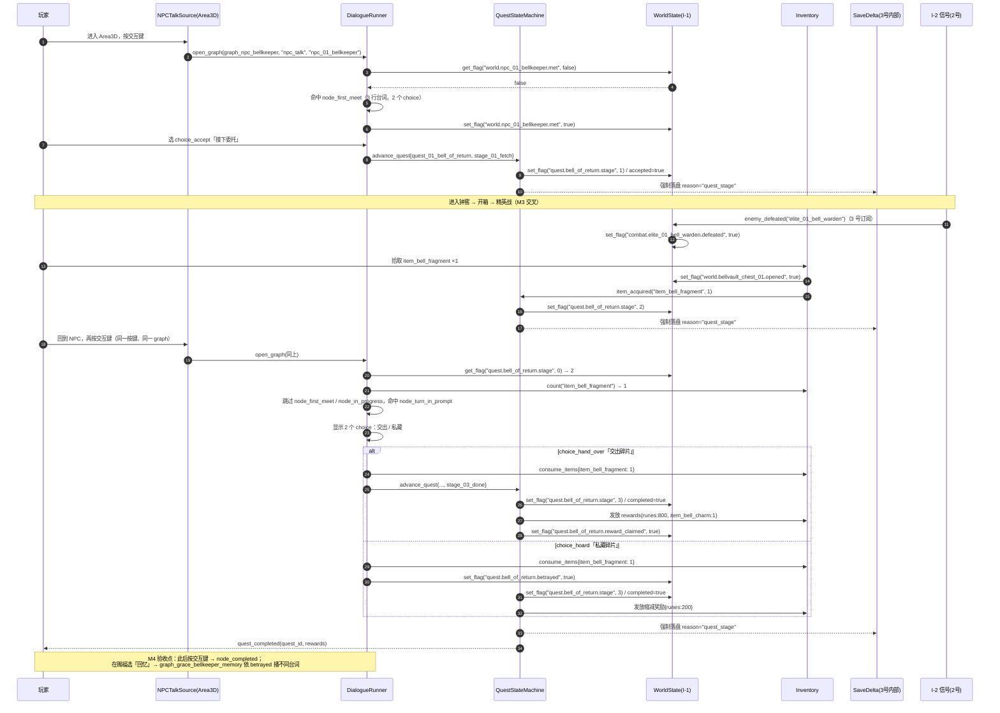

# RPG 系统设计（3 号工位 · v1.0）

> 覆盖总纲 **3.3（RPG 交互）** + 赐福传送网络 + Delta 持久化的上层逻辑，对应里程碑 **M3 / M4 / M6**。
> 依赖：`00-协作契约.md` I-1 / I-2 / I-3 / I-6；存档底层定义见同目录 `存档与flag规范.md`（I-1 权威）。
> **不负责**：渲染实现与场景树（1 号）、招式数值与战斗逻辑（2 号）、ComfyUI 与视觉规范（4 号）。
> 本文所有 Resource 字段名与 `dialogue_and_quest.tres` **逐字一致**；脚本路径为约定 `res://` 路径，由 1 号在工程目录规范中登记。

---

## 0. 模块分层

```
触发源层   NPCTalkSource / GraceTalkSource / GraceMemorySource   ← 只换触发源，不换对话系统
   ↓ open_graph(graph_id, trigger_source, trigger_owner_id)
对话层     DialogueRunner → DialogueGraph → DialogueNode → DialogueLine / DialogueChoice → DialogueGate
   ↓ set_flags / grant_items / consume_items / advance_quest
状态层     QuestStateMachine + WorldState(I-1) + Inventory + GraceNetwork
   ↓ flag_changed / delta_committed
持久层     SaveDelta（见《存档与flag规范.md》）
```

**关键设计决策**：触发源只负责"何时打开哪个图、以谁的身份"，不含任何分支逻辑。赐福处「交谈」与「回忆」调用的是**同一个 `DialogueRunner`、同一套 `DialogueGraph` 结构**，仅 `trigger_source` 与 `trigger_owner_id` 不同；`dialogue_and_quest.tres` 里同时给出 `graph_npc_bellkeeper`（NPC 交谈，主资源）与 `graph_grace_bellkeeper_memory`（赐福回忆，子资源）两个图，后者复用前者的 `DialogueNode` / `DialogueGate` 子资源，并挂在主资源的 `linked_graphs` 上（单文件即可按 `graph_id` 索引，不会出现孤立子资源）。

---

## 1. Resource 结构总表（与 .tres 逐字一致）

> 所有类 `extends Resource`，带 `class_name`，`@export`。数组字段统一声明为**非类型化 `Array`**（运行时用 `as` 断言元素类型），以保证手写的 `.tres` 在 Godot 4 下零歧义加载；`Array` 元素类型约定在"元素类型"列。

### 1.1 `DialogueGate` — 条件门控

脚本：`res://scripts/rpg/dialogue_gate.gd`

| 字段 | 类型 | 默认 | 说明 |
|---|---|---|---|
| `gate_id` | String | `""` | 门控 id，格式 `gate_<slug>` |
| `kind` | String | `"flag"` | `flag` / `item` / `quest_stage` 三选一 |
| `key` | String | `""` | `flag`→三段式 flag key；`item`→item_id；`quest_stage`→quest_id |
| `op` | String | `"eq"` | 见下表 |
| `value` | Variant | `true` | 仅 bool / int / float / String |
| `negate` | bool | `false` | 结果取反 |

| kind | 允许 op | value 语义 | 求值 |
|---|---|---|---|
| `flag` | `eq` / `ne` / `gte` / `lte` | 与登记类型一致 | `WorldState.get_flag(key, 基线默认)` 与 value 比较 |
| `item` | `has` / `not_has` / `gte` | int 数量阈值 | `Inventory.count(key)`；`has` ≡ `>= 1`；`gte` ≡ `>= value` |
| `quest_stage` | `eq` / `gte` / `lte` | int 阶段序号 | `QuestStateMachine.get_stage_index(key)`，序号从 0 起 |

- 一个 `Array` 内多个 gate 是 **AND**；需要 OR 用 `negate` 组合或拆成两条 Choice（本作规模不需要 OR 节点）。
- 求值**只发生在进入节点 / 显示选项的瞬间**，不缓存；M4 验收「flag 变化驱动对话分支」依赖这一点。
- **背包门控实例**：`gate_has_fragment` = `{kind:"item", key:"item_bell_fragment", op:"gte", value:1}`，玩家没拿到碎片时 `node_turn_in_prompt` 整个节点不可达，「交出碎片」选项也不会出现。

### 1.2 `DialogueLine`

脚本：`res://scripts/rpg/dialogue_line.gd`

| 字段 | 类型 | 默认 | 说明 |
|---|---|---|---|
| `line_id` | String | `""` | `line_<graph短名>_<序号>` |
| `speaker` | String | `""` | 显示名，赐福回忆用 `"记忆的余响"` 而非 NPC 名 |
| `text` | String | `""` | 中文正文，一句不超过 42 字（HD-2D 对话框宽度） |
| `gates` | Array | `[]` | 元素 `DialogueGate`；单行级门控，不满足则跳过该行 |
| `portrait_id` | String | `""` | 由 4 号资产清单提供；空串表示不显示立绘，`grace_memory` 图统一留空 |

### 1.3 `DialogueChoice`

脚本：`res://scripts/rpg/dialogue_choice.gd`

| 字段 | 类型 | 默认 | 说明 |
|---|---|---|---|
| `choice_id` | String | `""` | `choice_<slug>` |
| `text` | String | `""` | 选项文案 |
| `gates` | Array | `[]` | 元素 `DialogueGate`；不满足则**隐藏**该选项（不是灰显） |
| `next_node_id` | String | `""` | 跳转目标；空串表示结束对话 |
| `set_flags` | Dictionary | `{}` | `{flag_key: 值}`，逐条走 `WorldState.set_flag`（I-1） |
| `grant_items` | Dictionary | `{}` | `{item_id: int}`，发放 |
| `consume_items` | Dictionary | `{}` | `{item_id: int}`，扣除；不足则整个选项不显示 |
| `advance_quest` | Dictionary | `{}` | `{"quest_id": String, "stage_id": String, "reward_key": String}`，触发任务状态机推进并发放该阶段 `rewards`；`reward_key` 可选，用于选 `rewards.branch_overrides` 的分支奖励（见 §1.6） |
| `end_dialogue` | bool | `false` | 目标节点播完后是否直接收起对话框 |

**执行顺序（固定，不可调换）**：`consume_items` → `set_flags` → `advance_quest` → `grant_items` → 跳转。先扣后给，防止同 id 物品结算歧义；任务推进在发奖前，保证 `rewards` 能按新阶段取到。

### 1.4 `DialogueNode`

脚本：`res://scripts/rpg/dialogue_node.gd`

| 字段 | 类型 | 默认 | 说明 |
|---|---|---|---|
| `node_id` | String | `""` | 图内唯一 |
| `gates` | Array | `[]` | 元素 `DialogueGate`；**节点级**门控，不满足则跳过整个节点 |
| `lines` | Array | `[]` | 元素 `DialogueLine`，按序播放，≥1 行 |
| `choices` | Array | `[]` | 元素 `DialogueChoice`，空数组表示无分支 |
| `on_enter_flags` | Dictionary | `{}` | 进入节点即写（如 `world.npc_01_bellkeeper.met = true`） |
| `is_entry` | bool | `false` | 是否参与**入口解析**；`false` 的节点只能由 `DialogueChoice.next_node_id` 跳转到达 |
| `end_dialogue` | bool | `true` | 播完且无可用 choice 时关闭对话框 |

### 1.5 `DialogueGraph`

脚本：`res://scripts/rpg/dialogue_graph.gd`

| 字段 | 类型 | 默认 | 说明 |
|---|---|---|---|
| `graph_id` | String | `""` | `graph_<owner>_<用途>` |
| `trigger_source` | String | `"npc_talk"` | `npc_talk` / `grace_talk` / `grace_memory` |
| `trigger_owner_id` | String | `""` | NPC id 或 grace_id |
| `start_node_id` | String | `""` | 入口节点 |
| `nodes` | Array | `[]` | 元素 `DialogueNode` |
| `linked_quest` | Resource | `null` | 元素 `QuestData`，可为 null（纯闲聊图） |
| `linked_graphs` | Array | `[]` | 元素 `DialogueGraph`，把同一 `.tres` 内的其它图挂到主资源上，避免子资源孤立被丢弃；赐福回忆图即由此被访问 |

**入口解析规则（与 `dialogue_and_quest.tres` 一致）**：`DialogueRunner.open_graph()` 从 `start_node_id` 在 `nodes` 数组中的位置**向后扫描**，只考虑 `is_entry == true` 的节点，取第一个 `gates` 全通过者作为实际入口；全不通过则不弹对话框。`DialogueChoice.next_node_id` 的跳转目标**不检查 gates / is_entry**，直接播放（分支选择本身已完成门控）。`start_node_id` 不在 `nodes` 中时 `push_error`。

这让"同一 NPC、同一按键、不同 flag → 不同分支"完全靠 `.tres` 里的节点顺序与 gates 表达，不写任何 if-else。NPC 图的入口候选顺序为：

```
node_first_meet      [gate_never_met]                → 首见，3 行 + 2 选项
node_turn_in_prompt  [gate_has_fragment]             → 持有钟舌碎片，2 行 + 2 选项
node_declined        [gate_not_accepted]             → 拒绝后的兜底闲聊
node_in_progress     [gate_accepted + gate_stage_le_2] → 已接未交付
node_completed       [gate_stage_done]               → 任务完成
```

`node_declined` 同时是 choice 的跳转目标与入口兜底节点；「交出 / 私藏」两个 choice 的跳转目标 `node_turn_in_done` / `node_hoard_done` 与 `node_accepted` 都是 `is_entry = false`，不会被入口扫描误命中。赐福回忆图 `graph_grace_bellkeeper_memory` 的入口是 `node_grace_memory`（`gate_grace_lit`），并**复用** NPC 图的 `node_completed` 与 `gate_betrayed / gate_not_betrayed`。

### 1.6 `QuestStage` / `QuestData`

脚本：`res://scripts/rpg/quest_stage.gd`、`res://scripts/rpg/quest_data.gd`

| 类 | 字段 | 类型 | 默认 | 说明 |
|---|---|---|---|---|
| `QuestStage` | `stage_id` | String | `""` | `stage_<序号>_<slug>` |
| | `title` | String | `""` | 任务日志显示 |
| | `entry_flags` | Dictionary | `{}` | 进入该阶段要写入的 flag |
| | `on_complete_flags` | Dictionary | `{}` | 离开该阶段写入的 flag |
| | `rewards` | Dictionary | `{}` | `{"runes": int, "items": {item_id:int}, "flags": {flag_key:值}}` |
| | `next_stage_id` | String | `""` | 空串 = 终态 |
| `QuestData` | `quest_id` | String | `""` | `quest_<序号>_<slug>`（契约 §2） |
| | `display_name` | String | `""` | 任务名 |
| | `prerequisite_flags` | Dictionary | `{}` | 前置 flag，不满足不激活任务 |
| | `start_stage_id` | String | `""` | 初始阶段 |
| | `stages` | Array | `[]` | 元素 `QuestStage` |
| | `rewards` | Dictionary | `{}` | 全任务完成奖励，结构同上 |

**`rewards` 结构（`.tres` 中的奖励字段）**

```
{
  "runes": int,                  # 卢恩，交给 2 号背包结算
  "items": { item_id: int },     # 物品发放
  "flags": { flag_key: 值 },     # 领奖标记等
  "branch_overrides": {          # 可选：按 advance_quest.reward_key 覆盖
    "<reward_key>": { "runes": int, "items": {}, "flags": {} }
  }
}
```

- 奖励在**离开某阶段时**发放，即该阶段 `QuestStage.rewards`；本任务把交付奖励放在 `stage_02_return`：默认 `full` 给 `runes 800 + item_bell_charm ×1`，`betrayed` 覆盖为 `runes 200`（并写 `quest.bell_of_return.betrayed`）。
- `QuestData.rewards` 是全任务完成时的收尾标记（本任务 `runes = 0`，只写 `quest.bell_of_return.reward_claimed = true`），不与阶段奖励叠加计数。
- 分支由 `DialogueChoice.advance_quest.reward_key` 选择，不改 GDScript；新增分支只需在 `.tres` 里加一个 `branch_overrides` 键。

> 存档只存任务 id + 当前 stage_id + flag 集合（总纲 3.3），对应 `SaveDelta.quests`；`stages` 里的 `rewards` 是 Resource 基线数据，**不进存档**，靠 `quest.bell_of_return.reward_claimed` 防重复发放。

### 1.7 其它 Resource（本文定义，数据文件在 M3/M6 落地）

**`GraceNode`**（`res://scripts/rpg/grace_node.gd`）与 **`GraceNetwork`**（`res://scripts/rpg/grace_network.gd`）见 §4.1。
**`SpawnRequest`**（`res://scripts/rpg/spawn_request.gd`）字段集见 `接口契约.md` §3（I-3 权威）。
**`InteractableSpec`**（`res://scripts/rpg/interactable_spec.gd`）见 §3.1。

---

## 2. 任务系统：信号 + 状态机

### 2.1 状态机

```
[not_active] --prerequisite_flags 满足--> [stage_00_offer]
     ↑                                        │ 选择「接下委托」
     │                                        ↓  advance_quest
     │                                   [stage_01_fetch]  ← 取钟舌碎片
     │                                        │  item_bell_fragment >= 1
     │                                        ↓
     │                                   [stage_02_return] ← 回 NPC 交付 / 私藏
     │                                        │  选择分支结算
     │                                        ↓
     └──────────────（不可回退）──────── [stage_03_done / terminal]
```

- 状态机由 `QuestStateMachine`（3 号节点，`res://scripts/rpg/quest_state_machine.gd`）持有，一张 `quest_id → QuestData + 当前 stage index` 表。
- **阶段只前进不回退**；`advance_quest` 收到更早的 stage_id 时忽略并 `push_warning`（防对话重复触发刷奖励）。
- 阶段推进统一走 `WorldState.set_flag("quest.<对象>.stage", int)`，`QuestStage.entry_flags` 与 `rewards.flags` 也逐条走 `set_flag`，因此所有阶段变化天然进 Delta。
- **`stage_01_fetch → stage_02_return` 不走对话**：3 号 `Inventory` 发 `item_acquired(item_id: String, count: int)`，`QuestStateMachine` 订阅后检测到 `item_id == "item_bell_fragment"` 且当前 stage 为 1，自动写 `quest.bell_of_return.stage = 2` 并强制落盘 `reason="quest_stage"`。对话侧的 `gate_has_fragment`（背包门控）与 `gate_stage_fetch`（阶段门控）互为双保险，任一处数据缺失都不会误开交付分支。

### 2.2 信号表（3 号对外 / 对内）

| 方向 | 信号 | 参数 | 说明 |
|---|---|---|---|
| 3 → 全体 | `quest_started(quest_id: String)` | String | 任务激活，UI 弹提示 |
| 3 → 全体 | `quest_stage_changed(quest_id: String, stage_id: String, stage_index: int)` | 3 参数 | 日志 / UI / 赐福回忆门控 |
| 3 → 全体 | `quest_completed(quest_id: String, rewards: Dictionary)` | 2 参数 | 结算展示 |
| 3 → 3 | `dialogue_opened(graph_id: String, trigger_source: String)` | 2 参数 | 内部，供相机 / 输入锁定 |
| 3 → 3 | `dialogue_closed(graph_id: String)` | 1 参数 | 内部 |
| 2 → 3（I-2） | `enemy_defeated(enemy_id: String)` / `boss_defeated(boss_id: String)` | String | 3 号订阅后写 Delta，见 §5 |
| 3 → 主 AI（I-6） | — | — | M0~M6 交付表见 `接口契约.md` §5 |

> 3 号**不新增**全局事件总线；上述信号挂在 `QuestStateMachine` 与 `DialogueRunner` 节点上，1 号通过节点组 `rpg_signals` 查找订阅，不依赖 2 号的 `GameEvents` 命名（该命名差异见 `README.md` 待裁决 A2）。

### 2.3 NPC 任务闭环时序图（M4 验收）

任务：`quest_01_bell_of_return`「归乡之铃」；NPC：`npc_01_bellkeeper` 守钟人·伊莱；关键物品 `item_bell_fragment`（钟窖 B2 宝箱）。



**M4 验收「flag 变化驱动对话分支」的可复核操作**

| 步骤 | 操作 | 期望 |
|---|---|---|
| 1 | 新档，`quest.bell_of_return.stage = 0` 与 NPC 交谈 | 出现 `node_first_meet`，3 行台词 + 2 选项 |
| 2 | 选「我再想想」后立刻再交谈 | 首见 3 行不再出现，命中 `node_declined`「不急。钟不会跑」（`gate_not_accepted` 兜底，不出现空对话） |
| 3 | 新档选「接下委托」，无碎片时交谈 | 变 `node_in_progress`（2 行催促），**没有**「交出碎片」选项 |
| 4 | 拿到碎片后交谈 | 变 `node_turn_in_prompt`，出现「交出 / 私藏」2 选项 |
| 5 | 选「私藏」后去赐福选「回忆」 | 因 `betrayed = true`，播 `L14`「你把钟舌留在了自己手里」而非常规台词 |
| 6 | 退出重进游戏 | 上述分支全部保持（Delta 已落盘） |

---

## 3. 拾取 / 门 / 隐藏墙 / 单向门

### 3.1 统一交互件 `InteractableSpec`

所有交互物都是 `Area3D` + `InteractableSpec` Resource（`res://scripts/rpg/interactable_spec.gd`），字段：

| 字段 | 类型 | 说明 |
|---|---|---|
| `spec_id` | String | 与 flag 对象段一致，如 `bellvault_chest_01` |
| `kind` | String | `pickup` / `door` / `one_way_door` / `hidden_wall` / `lift` / `grace` / `npc_talk` / `grace_memory` |
| `flag_key` | String | 三段式 key，如 `world.bellvault_chest_01.opened` |
| `flag_value` | Variant | 触发后写入的值 |
| `prompt_enabled` | bool | 是否显示提示图标（**hidden_wall 必须 false**） |
| `prompt_icon` | String | 4 号资产清单里的图标 id（金线风格） |
| `prompt_offset` | Vector3 | 提示图标相对 Area3D 的偏移 |
| `area_size` | Vector3 | Area3D 的 BoxShape3D 尺寸 |
| `item_id` / `item_count` | String / int | kind=pickup 时发放 |
| `open_side` | String | kind=one_way_door 时，允许开启的一侧（`b3_side`） |
| `target_floor` | int | kind=lift 时的目标层 |
| `delta_checkpoint` | bool | 触发后是否强制落盘 |
| `graph_id` | String | kind=npc_talk / grace_memory 时打开的对话图 |

### 3.2 交互通用流程

```
body_entered(Area3D)
  → 查 spec.prompt_enabled：true 则显示提示图标（金线 UI，1 号渲染）
  → 按交互键 → 校验 spec 前置（flag / item / 单向门侧）
  → 写 WorldState.set_flag(spec.flag_key, spec.flag_value)     [I-1]
  → 发 spec kind 对应表现信号（开盖动画 / 门旋转 / 拾取入包）
  → spec.delta_checkpoint == true → 强制落盘
  → 销毁或隐藏该 Area3D 的可交互性（只读 flag，不靠实例状态跨场景携带）
```

**Delta 持久化的关键**：交互物**不把自己"已用过"存在节点实例里**，一律 `get_flag` 判定。1 号做 chunk 加载 / 卸载时，重建出来的宝箱读 flag 就知道该不该显示开盖态，M2「往返走不重复加载」与 M3「Delta 持久化正确」共用这一机制。

### 3.3 隐藏墙（硬约束）

- `kind = "hidden_wall"`、`prompt_enabled = false`、`prompt_icon = ""`。
- **不给任何提示**：不显示图标、不显示文字、无高亮、无音效提示、无震动、无敌意粒子、不进小地图 POI 列表、不在任务日志里明写位置。
- 只能被玩家攻击命中（`hurtbox` 命中回调）触发；命中后写 `world.bellvault_hidden_wall_01.revealed = true`，并 `set_flag` 同步 `world.bellvault_chest_02.opened` 的可达性。
- 隐藏墙后必须有实打实奖励（本模板：`item_smithing_stone_01 × 2`），否则"密度优先"无从谈起。

### 3.4 单向门 / 捷径规则

| 规则 | 内容 |
|---|---|
| 方向 | `open_side = "b3_side"`：只有玩家站在井底 B3 一侧时，交互校验通过 |
| 反侧 | 从 B1 一侧靠近**不显示提示图标**、按键无响应（`prompt_enabled` 在 B1 侧由脚本按 `open_side` 动态屏蔽） |
| 开启 | 按交互键 → `set_flag("world.bellvault_shortcut_door_01.unlocked", true)` + `set_flag("dungeon.bellvault.shortcut_opened", true)`，同批写 |
| 开启后 | 双向可通行（法环式捷径：门本身变成普通通道），但**不能从 B1 侧重新锁上**；`unlocked` 是单调 flag |
| 落盘 | `delta_checkpoint = true`，`reason = "shortcut_opened"` |
| 传送接入 | M3 只写 `grace.bellvault_entry.visited`；M6 增量以 `dungeon.bellvault.shortcut_opened` 作为井底赐福 `grace_bellvault_deep` 网络边的 `requires_flags`（M3 不放井底赐福，保证地牢「1 赐福」） |
| 加载 | 门属于地牢内部，**不跨 chunk 边界**；短加载后读 flag 重建状态 |

### 3.5 门 / 隐藏墙 / 升降机状态全部收敛进 flags（INV-6）

| 交互物 | flag | 类型 |
|---|---|---|
| 普通门 | `world.<door_id>.unlocked` | bool |
| 单向门 | `world.<door_id>.unlocked` + `dungeon.<dungeon_id>.shortcut_opened` | bool |
| 隐藏墙 | `world.<wall_id>.revealed` | bool |
| 升降机 | `world.<lift_id>.position`(int 层) + `world.<lift_id>.unlocked` | int / bool |
| 宝箱 | `world.<chest_id>.opened` | bool |
| 拾取物 | `world.<pickup_id>.taken` | bool |

---

## 4. 赐福传送网络

### 4.1 节点图数据结构

`GraceNetwork` 是**无向图 + 带条件的边**，节点与边都存成 Resource（不散落在场景里）：

| 类 | 字段 | 类型 | 说明 |
|---|---|---|---|
| `GraceNode` | `grace_id` | String | `grace_<区域>_<地点>`，与 flag 对象段一致 |
| | `display_name` | String | 传送菜单显示名 |
| | `area_id` | String | 所属区域 / 地牢 id |
| | `scene_path` | String | `res://` 场景路径（1 号 chunk / 地牢场景） |
| | `spawn_marker` | String | 传送落点 Marker3D 名 |
| | `lit_flag` / `unlocked_flag` | String | `grace.<对象>.lit` / `grace.<对象>.unlocked` |
| | `requires_flags` | Dictionary | 该节点可被发现的前置（如 `dungeon.bellvault.entered`） |
| | `neighbors` | Array | 元素为 grace_id String，用于菜单排序 |
| | `is_dungeon` | bool | 地牢节点在菜单里分组显示 |
| | `discover_radius` | float | 点亮距离，默认 `12.0` m |
| `GraceNetwork` | `network_id` | String | `network_01_lands_between` |
| | `nodes` | Array | 元素 `GraceNode` |
| | `edges` | Array | 元素 Dictionary：`{"from": String, "to": String, "requires_flags": Dictionary}` |

**解锁 flag 命名（严格三段式）**

```
grace.<grace_id 去掉 "grace_" 前缀>.lit        # 是否点燃，bool
grace.<同对象>.unlocked                        # 是否进入传送网络，bool
grace.<同对象>.visited                         # 是否到访过，bool
grace.network.last_rest_epoch                  # 全局休息计数，int
grace.network.last_grace_id                    # 复活 / 传送锚点，String
```

例：`grace_limgrave_gatefront` → `grace.limgrave_gatefront.lit`、`grace.limgrave_gatefront.unlocked`。

### 4.2 点亮 / 传送 / 休息流程

**点亮**：靠近 `discover_radius` → 交互 → `set_flag(lit_flag, true)` → `set_flag(unlocked_flag, true)` → `set_flag("grace.network.last_grace_id", grace_id)` → 强制落盘 `reason="grace_lit"` → 传送菜单即时插入该节点（按 `neighbors` 排序）。

**传送**（赐福菜单选目标）：

```
1 校验目标 unlocked_flag == true 且 edges[*].requires_flags 全部满足
2 强制落盘 reason="grace_fast_travel"（离开当前区域前，见《存档与flag规范》§4.8）
3 发 travel_requested(target_grace_id) 给 1 号 SceneRouter / ChunkManager
4 淡出（0.3 s）→ 短加载遮罩 → 按 GraceNode.scene_path 加载 → 落到 spawn_marker
5 3 号只写 last_grace_id 与 visited，**不负责**场景切换实现（1 号）
6 淡入，输入解锁
```

> 传送不刷新敌人、不回血；回血与刷新只发生在「休息」。

**休息**（赐福菜单选「休息」）：

```
1 写 grace.network.last_rest_epoch += 1 → spawns.epoch 同步
2 刷新 respawn_policy="on_grace_rest" 的普通敌人，精英/Boss 不刷新
3 set_flag("grace.network.last_grace_id", 当前 grace_id)
4 发 rest_completed(grace_id, epoch) → 2 号据此回血 / 补瓶 / 清异常积累（战斗数值属 2 号）
5 强制落盘 reason="grace_rest"
6 若当前图有 grace_memory 触发源，菜单中「回忆」项点亮
```

**与 Delta 的关系**：赐福状态没有任何私有存档结构，全部是 `grace.*` flags；`last_rest_epoch` 是唯一驱动敌人刷新的 Delta 字段。传送是**强制落盘点**，因为它跨越 1 号的加载边界，是丢状态风险最高的一步。

### 4.3 M6 网络拓扑（3~4 区域 + 2 地牢 + 1 地下入口）

| # | grace_id | 显示名 | area_id | 类型 | 发现前置 |
|---|---|---|---|---|---|
| 1 | `grace_limgrave_gatefront` | 关卡前 | `area_limgrave` | 区域 | 无（初始点亮） |
| 2 | `grace_limgrave_chapel` | 巡礼教堂 | `area_limgrave` | 区域 | 无 |
| 3 | `grace_weeping_shore` | 啜泣海岸 | `area_weeping_peninsula` | 区域 | `world.limgrave_bridge_01.crossed` |
| 4 | `grace_stormveil_gate` | 史东薇尔城门 | `area_stormveil_outskirts` | 区域 | `combat.boss_01_margit.defeated` |
| 5 | `grace_bellvault_entry` | 钟窖入口 | `dungeon_01_bellvault` | 地牢 | `dungeon.bellvault.entered` |
| 6 | `grace_bellvault_deep` | 钟窖井底 | `dungeon_01_bellvault` | 地牢 | `dungeon.bellvault.shortcut_opened` |
| 7 | `grace_sunless_tomb_entry` | 无日之墓门厅 | `dungeon_02_sunless_tomb` | 地牢 | `dungeon.sunless_tomb.entered` |
| 8 | `grace_siofra_well` | 希芙拉河井底 | `underground_01_siofra_well` | 地下入口 | `world.siofra_well_lift_01.unlocked` |

**边（无向，条件写在边上）**

```
grace_limgrave_gatefront ── grace_limgrave_chapel                    [无条件]
grace_limgrave_gatefront ── grace_weeping_shore                     [world.limgrave_bridge_01.crossed]
grace_limgrave_chapel    ── grace_stormveil_gate                    [combat.boss_01_margit.defeated]
grace_limgrave_gatefront ── grace_bellvault_entry                   [dungeon.bellvault.entered]
grace_bellvault_entry    ── grace_bellvault_deep                    [dungeon.bellvault.shortcut_opened]
grace_weeping_shore      ── grace_sunless_tomb_entry                [dungeon.sunless_tomb.entered]
grace_limgrave_gatefront ── grace_siofra_well                       [world.siofra_well_lift_01.unlocked]
```

> 地下入口是 `area` 与 `dungeon` 之间的第三种拓扑：由地表升降机（`world.siofra_well_lift_01.position = 2`）接入，节点 `is_dungeon = false` 但出现在独立「地下」分组。3 号不为它新增 flag 前缀，沿用 `world.` / `dungeon.`（命名空间表只有 5 个前缀）。

**M6「可完整跑通一条探索线」验收路径**：

```
关卡前赐福(1) → 与守钟人伊莱接任务 → 钟窖入口(5) → B1 回廊 → B2 钟厅(精英+碎片)
→ B3 井底开单向门捷径 → 井底赐福(6) 点亮 → 传送回关卡前(1) → 交付「归乡之铃」
→ 过桥到啜泣海岸(3) → 无日之墓门厅(7) → 击杀恶兆解锁史东薇尔城门(4)
→ 地表升降机下沉到希芙拉河井底(8)
```
每一步都对应至少一个强制落盘点，退出重进后赐福网络边与任务阶段可复原。

### 4.4 触发源复用（赐福「交谈 / 回忆」）

| 触发源 | `trigger_source` | `trigger_owner_id` | 打开的图 | 差异 |
|---|---|---|---|---|
| NPC 交谈 | `npc_talk` | `npc_01_bellkeeper` | `graph_npc_bellkeeper` | 立绘显示、speaker 为 NPC 名 |
| 赐福「交谈」 | `grace_talk` | `grace_limgrave_gatefront` | 同一 `DialogueRunner`，`graph_id` 由赐福节点配置 | 无立绘，speaker 为 NPC 名 |
| 赐福「回忆」 | `grace_memory` | `grace_bellvault_entry` | `graph_grace_bellkeeper_memory` | 无立绘、speaker `"记忆的余响"`、`portrait_id = ""`、复用 NPC 图的节点 |

三者共用 `DialogueRunner.open_graph(graph_id, trigger_source, trigger_owner_id)` 一个入口，`trigger_source` 只影响：立绘开关、speaker 覆盖、UI 底色（金线深蓝 / 回忆用冷夜雾色）、是否允许 choice。**不复制对话逻辑，不新建第二套系统**。

---

## 5. 接口衔接（不越界）

| 编号 | 3 号侧行为 |
|---|---|
| I-1 | 3 号提供 `WorldState`；自己内部也**只经** `get_flag / set_flag` 写状态，保证 1/2 号看到的语义一致 |
| I-2 | `SaveDeltaWriter` 订阅 2 号 `enemy_defeated(enemy_id: String)` / `boss_defeated(boss_id: String)`，查 `SpawnRequest.defeated_flag` 写 `combat.<id>.defeated`，强制落盘；**2 号不写 flag**，避免双写 |
| I-3 | 地牢模板给出完整 `SpawnRequest`，2 号消费；字段集见 `接口契约.md` §3 |
| I-6 | M0~M6 分阶段交付表见 `接口契约.md` §5 |

---

## 6. 落地清单与验收

| 类别 | 路径 | 说明 |
|---|---|---|
| 脚本（约定） | `res://scripts/rpg/dialogue_gate.gd`、`dialogue_line.gd`、`dialogue_choice.gd`、`dialogue_node.gd`、`dialogue_graph.gd`、`quest_stage.gd`、`quest_data.gd` | 7 个 Resource 类，`.tres` 依赖它们 |
| 脚本（约定） | `res://scripts/rpg/dialogue_runner.gd`、`quest_state_machine.gd`、`interactable_spec.gd`、`grace_node.gd`、`grace_network.gd`、`spawn_request.gd`、`save_delta_writer.gd` | 运行逻辑 |
| 数据 | `res://data/dialogue/dialogue_and_quest.tres` | 本工位交付的 `dialogue_and_quest.tres` 直接拷入 |
| 数据 | `res://data/grace/grace_network.tres`、`res://data/dungeons/dungeon_01_bellvault.tres`、`res://data/world_baseline.tres` | M3 / M6 阶段按本文结构生成 |
| 单例 | `res://autoload/world_state.gd`（Autoload `WorldState`） | 1 号注册，3 号实现 |

**验收口径**

| 里程碑 | 判定 |
|---|---|
| M3 | 钟窖短加载进出后，宝箱 / 单向门 / 隐藏墙 / 升降机 / 精英击杀状态全部保持；赐福可点亮并可传送回地表 |
| M4 | §2.3 六步全部符合；改 `.tres` 的 `set_flags` 或 gate 即改变分支，**不改任何 GDScript** |
| M6 | 8 个赐福节点按 §4.3 拓扑可达，7 条边的前置 flag 生效；§4.3 探索线可完整跑通，中途退出重进不断线 |
| 通用 | 全量 flag 通过三段式正则；隐藏墙在全部 UI / 日志 / 小地图里零提示；数据表改数值不改代码 |
